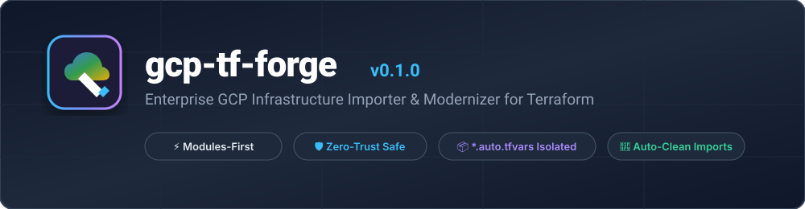
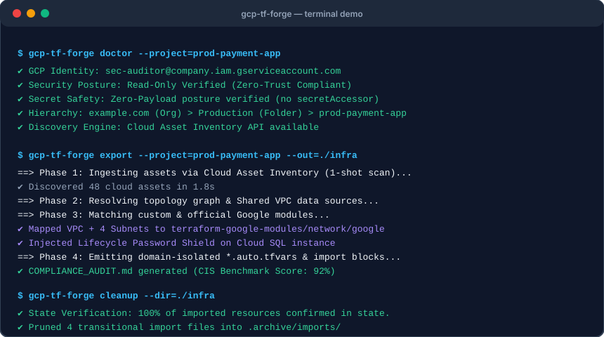
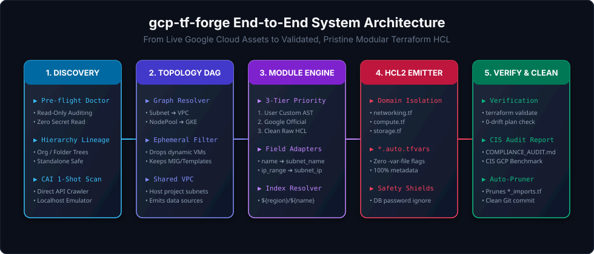

<p align="center">
  
</p>

<p align="center">
  <a href="https://opensource.org/licenses/Apache-2.0"></a>
  <a href="https://github.com/norahul1020/gcp-tf-forge/actions/workflows/ci.yml"></a>
  <a href="https://goreportcard.com/report/github.com/norahul1020/gcp-tf-forge"></a>
  <a href="https://terraform.io">=1.5.0-623CE4.svg" alt="Terraform"></a>
</p>

---

`gcp-tf-forge` is an enterprise-grade, open-source CLI engine specifically built to reverse-engineer Google Cloud Platform infrastructure into **clean, maintainable, modular Terraform HCL**.

Unlike legacy tools that output hundreds of flat, unmanageable raw resources, `gcp-tf-forge`:
- 🧩 **Synthesizes resources into Terraform Modules** (Your internal custom modules first, official Google modules second, and clean raw HCL as fallback).
- 📦 **Separates configurations into domain-isolated `.auto.tfvars`** (`networking.auto.tfvars`, `compute.auto.tfvars`, `storage.auto.tfvars`).
- 🛡️ **Enforces Zero-Trust Security**: Never reads secret payloads and automatically injects lifecycle shields for database passwords and cloud APIs.
- 🎯 **Eliminates False Drift**: Reconciles GCP API defaults with Terraform Provider defaults for a verified `0 to add, 0 to change, 0 to destroy` plan.
- 🧹 **Cleans up after itself**: Generates native Terraform 1.5+ `import {}` blocks, and prunes them automatically once resources are bound to state.

---

## 📺 Interactive Terminal Demo

<p align="center">
  
</p>

---

## 🚀 Quick Start

### 1. Installation

#### Via Go Install:
```bash
go install github.com/norahul1020/gcp-tf-forge/cmd/gcp-tf-forge@latest
```

#### From Source:
```bash
git clone https://github.com/norahul1020/gcp-tf-forge.git
cd gcp-tf-forge
make build
sudo mv bin/gcp-tf-forge /usr/local/bin/
```

### 2. Run Pre-flight Doctor
Check your active GCP authentication, read-only permissions, and hierarchy ancestry:
```bash
gcp-tf-forge doctor --project=my-production-app
```

### 3. Dry-Run Plan & Module Preview
Scan the cloud and preview how resources will be mapped into modules without writing any files:
```bash
gcp-tf-forge plan \
  --project=my-production-app \
  --custom-modules=./my-company-modules/
```

### 4. Export Clean Modular Terraform Code
Generate domain-separated HCL files, typed variables, and modern `import {}` blocks:
```bash
gcp-tf-forge export \
  --project=my-production-app \
  --custom-modules=./my-company-modules/ \
  --out=./infra-code/
```

### 5. Verify & Import State
Run non-destructive validation and state binding:
```bash
cd ./infra-code
terraform init
terraform plan
terraform apply
```

### 6. Clean Up Transitional Import Files
Verify 100% state binding and prune all `*_imports.tf` before committing to Git:
```bash
gcp-tf-forge cleanup --dir=./infra-code
git add .
git commit -m "feat(infra): reverse-engineered production infra via gcp-tf-forge"
```

---

## 🏛️ System Architecture

<p align="center">
  
</p>

---

## 🛡️ Enterprise Safety Features

- **Zero-Secret Payload Guarantee**: Strictly queries Secret Manager metadata (`roles/secretmanager.viewer`). Never queries secret versions or payloads (`roles/secretmanager.secretAccessor` is blocked).
- **Database Password Shield**: Injects `lifecycle { ignore_changes = [password] }` to ensure production database passwords are never overwritten.
- **API Destruction Shield**: Injects `disable_on_destroy = false` and `prevent_destroy = true` on `google_project_service`.
- **Shared VPC Awareness**: External host project subnets are emitted as `data` sources, preventing cross-project state pollution.
- **CIS GCP Foundations Linter**: Automatically produces `COMPLIANCE_AUDIT.md` scoring the infrastructure against CIS Benchmark v3.0.

---

## 📄 Documentation

For deep technical details, see:
- [Architecture Specification & RFC](docs/ARCHITECTURE.md)
- [Writing Custom Module Adapters](docs/CUSTOM_MODULE_GUIDE.md)
- [CIS GCP Compliance Benchmark Guide](docs/COMPLIANCE_GUIDE.md)

---

## 🤝 Contributing

Contributions are welcome! Please see our [Contributing Guide](CONTRIBUTING.md) and [Code of Conduct](CODE_OF_CONDUCT.md).

## ⚖️ License

Distributed under the Apache 2.0 License. See [LICENSE](LICENSE) for more information.
