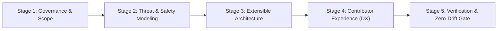
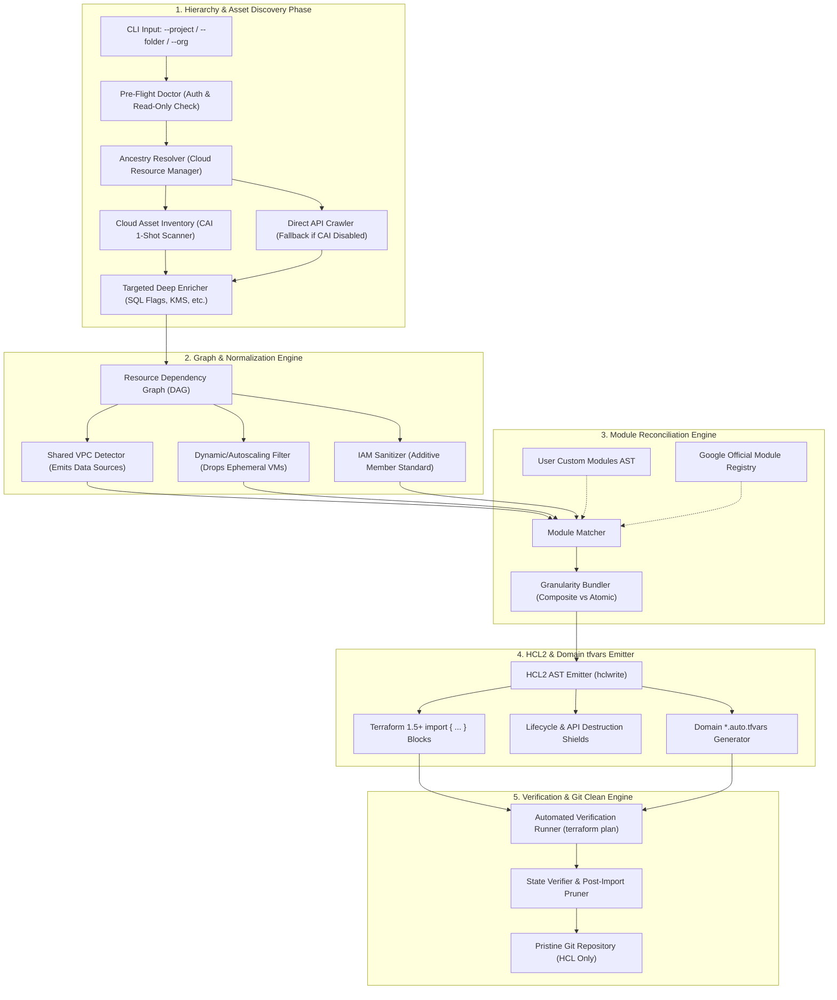
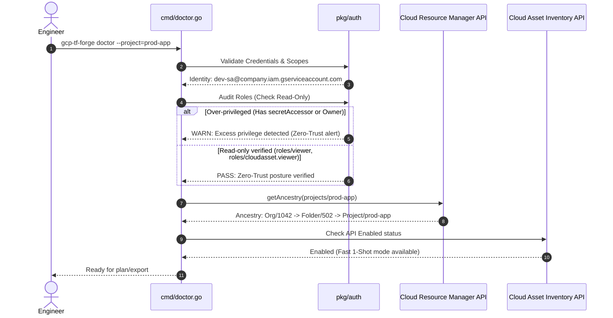
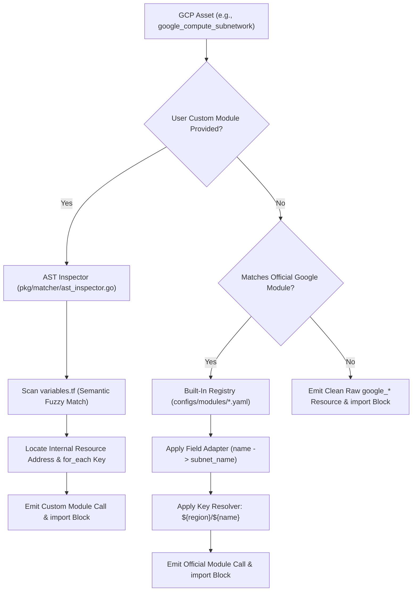

# GCP Terraform Importer & Modernizer (`gcp-tf-forge`)
## Architecture Design Document & Open-Source Product Specification
**Document Version:** 1.0.0  
**Author:** Google Engineering Lead & Senior Staff Terraform Architect  
**Status:** Approved for Implementation  
**License:** Apache 2.0 (Open Source)

---

## 1. Executive Summary & Product Vision

### 1.1 The Problem Statement
Existing infrastructure reverse-engineering tools (such as `terraformer`, `terracognita`, and `gcloud beta resource-config bulk-export`) suffer from catastrophic design flaws that prevent adoption in modern enterprise environments:
1. **Monolithic Raw Dumps:** They output hundreds of unmaintainable, low-level `google_*` flat resource blocks without modular abstraction.
2. **Zero Custom Module Awareness:** They cannot map discovered assets into Google Cloud’s official modules (`terraform-google-modules/*`) or an enterprise's internal custom modules.
3. **Destructive Drift & Out-of-Sync Hazards:** They trigger accidental resource recreation (`Forces replacement`), overwrite database passwords with dummy values, or fail on Shared VPC cross-project dependencies.
4. **State Corruption & Lockout Traps:** They attempt to craft synthetic `.tfstate` files directly or generate authoritative IAM bindings (`google_project_iam_binding`) that wipe out Google internal service agents and lock administrators out of projects.

### 1.2 The Solution: `gcp-tf-forge`
`gcp-tf-forge` is an enterprise-grade, open-source CLI engine specifically built for Google Cloud Platform that:
- **Discovers** all cloud assets across any GCP hierarchy (Standalone Project, Organization, Folders, Shared VPC).
- **Synthesizes** resources into **Terraform Modules** (User Custom Modules first, Official Google Modules second, Raw HCL as fallback).
- **Isolates** configuration into domain-specific, auto-loaded `*.auto.tfvars` (`networking.auto.tfvars`, `compute.auto.tfvars`, etc.).
- **Enforces Zero-Trust Security**: Never queries secret payloads; injects lifecycle shields for databases and cloud APIs.
- **Validates & Cleans**: Generates native Terraform 1.5+ `import {}` blocks, validates zero drift via `terraform plan`, and automatically prunes transitional import files prior to Git commit.

---

## 2. Google Engineering Lead Pre-Implementation Framework

When launching a Google Cloud open-source project intended for global community adoption, we follow a strict 5-stage pre-implementation framework:



1. **Governance & Non-Invasive Stance:** The tool must have **zero runtime dependencies post-import**. Once the code is imported into `.tfstate`, the user owns pure, standard Terraform HCL.
2. **Threat & Safety Modeling:** Read-only execution against GCP APIs. Physical impossibility of secret exfiltration. Pre-flight verification of credentials.
3. **Extensibility via Schema Ingestion:** Avoid hardcoded resource logic. Leverage the official Terraform Google Provider JSON schema (`terraform providers schema -json`) to scale to 600+ resources automatically.
4. **Developer Experience (DX):** Fast interactive terminal UI (`bubbletea`/`lipgloss`), instant dry-run previews, deterministic naming collision resolution, and automated CIS compliance audits.
5. **Zero-Drift Verification Gate:** Automated testing against live cloud infrastructure verifying: `Plan: N to import, 0 to add, 0 to change, 0 to destroy`.

---

## 3. High-Level System Architecture

The following diagram illustrates the complete end-to-end data processing pipeline:



---

## 4. Git Repository Architecture

The repository adheres strictly to standard Go enterprise layout (`golang-standards/project-layout`) for maintainability and community contribution:

```
gcp-tf-forge/
├── .github/
│   ├── workflows/
│   │   ├── ci.yml                    # Unit tests, linting, race detection
│   │   ├── e2e-gcp.yml               # Integration tests against live GCP sandbox
│   │   └── release.yml               # GoReleaser (Multi-OS single binaries)
│   ├── ISSUE_TEMPLATE/
│   │   ├── bug_report.md
│   │   └── module_adapter_request.md
│   └── PULL_REQUEST_TEMPLATE.md
│
├── cmd/                              # CLI Command Suite (Cobra + Lipgloss)
│   ├── gcp-tf-forge/
│   │   └── main.go                   # Single binary entrypoint
│   ├── doctor.go                     # Pre-flight credential, permission & hierarchy check
│   ├── plan.go                       # In-memory scan, module matching & dry-run preview
│   ├── export.go                     # Full HCL, *.auto.tfvars, and import code generator
│   ├── verify.go                     # Local terraform validate & plan verification runner
│   ├── cleanup.go                    # Post-import state verification & imports.tf pruner
│   └── root.go                       # Global flags, logging, and versioning
│
├── pkg/
│   ├── auth/                         # GCP Auth, Identity Resolution & Permission Auditing
│   │   ├── credentials.go            # ADC & Service Account Key resolution
│   │   └── doctor.go                 # Verifies read-only posture (blocks secretAccessor)
│   │
│   ├── hierarchy/                    # GCP Hierarchy Traversal Engine
│   │   ├── ancestry.go               # Detects Standalone vs Org vs Nested Folder trees
│   │   └── boundary.go               # Separates project-owned vs inherited policies
│   │
│   ├── discovery/                    # High-Performance Discovery Engine
│   │   ├── cai_scanner.go            # Cloud Asset Inventory 1-shot batch extraction
│   │   ├── direct_crawler.go         # Fallback crawler for Compute, SQL, GKE, IAM
│   │   └── enricher.go               # Targeted deep GETs for complex attributes
│   │
│   ├── graph/                        # Resource Topology & DAG Builder
│   │   ├── node.go                   # Normalized GCP Resource Node
│   │   ├── dag.go                    # Directed Acyclic Graph resolution
│   │   ├── relationships.go          # Links Subnet->VPC, NodePool->Cluster, Disk->VM
│   │   └── shared_vpc.go             # Resolves Host vs Service Project data sources
│   │
│   ├── matcher/                      # Module Mapping Engine (Hybrid Model)
│   │   ├── ast_inspector.go          # Parses user custom modules AST (main.tf, vars.tf)
│   │   ├── registry.go               # Built-in specs for terraform-google-modules/*
│   │   ├── adapter.go                # Translates raw GCP fields -> Module inputs
│   │   ├── key_resolver.go           # Deduces exact for_each index keys for imports
│   │   └── bundler.go                # Handles Composite (all-in-1) vs Atomic modules
│   │
│   ├── hclgen/                       # HCL2 AST Code Generation (hclwrite)
│   │   ├── writer.go                 # AST file generator (formatted HCL)
│   │   ├── schema_filter.go          # Reconciles provider schema; strips computed noise
│   │   ├── tfvars_emitter.go         # Emits typed domain-specific *.auto.tfvars
│   │   ├── id_synthesizer.go         # Deterministic Terraform 1.5+ import IDs
│   │   ├── shields.go                # Injects lifecycle ignore_changes & prevent_destroy
│   │   └── naming.go                 # Sanitizes illegal chars & resolves name collisions
│   │
│   ├── compliance/                   # CIS GCP Foundations Compliance Engine
│   │   ├── evaluator.go              # Evaluates assets against CIS GCP Benchmark v3.0
│   │   └── report_generator.go       # Emits COMPLIANCE_AUDIT.md and auto-fixes
│   │
│   ├── brownfield/                   # Out-of-Sync & Drift Engine
│   │   ├── state_diff.go             # Ingests existing .tfstate to skip managed assets
│   │   ├── hazard_detector.go        # Identifies and blocks "forces replacement" triggers
│   │   └── clickops_report.go        # Emits DRIFT_AND_CLICKOPS_REPORT.md
│   │
│   └── verifier/                     # Terraform Execution Wrapper
│       ├── terraform_cli.go          # Invokes local terraform/tofu CLI safely
│       └── plan_parser.go            # Asserts 0 drift (0 add, 0 change, 0 destroy)
│
├── configs/                          # Declarative Module Adapters
│   ├── modules/
│   │   ├── network.yaml              # Specs for terraform-google-modules/network/google
│   │   ├── gke.yaml                  # Specs for terraform-google-modules/kubernetes-engine
│   │   ├── cloud_storage.yaml        # Specs for terraform-google-modules/cloud-storage
│   │   ├── sql_db.yaml               # Specs for terraform-google-modules/sql-db
│   │   └── cloud_router.yaml         # Specs for terraform-google-modules/cloud-router
│   └── compliance_rules.yaml         # CIS benchmark rule definitions
│
├── test/
│   ├── fixtures/                     # Mock GCP CAI asset JSON dumps
│   ├── mock_modules/                 # Sample custom modules for AST unit testing
│   └── e2e/                          # Integration test scripts
│
├── docs/                             # Documentation & Diagrams
│   ├── ARCHITECTURE.md               # Deep architectural explanation
│   ├── CUSTOM_MODULE_GUIDE.md        # Guide on writing custom module adapters
│   └── COMPLIANCE_GUIDE.md           # CIS benchmark mapping details
│
├── go.mod
├── go.sum
├── Makefile                          # Build, test, lint, and run targets
├── LICENSE                           # Apache 2.0
└── README.md                         # Quickstart, installation, and demos
```

---

## 5. Detailed Component Workflows

### 5.1 Pre-Flight Doctor & Ancestry Resolution


### 5.2 Module Mapping & AST Adapter Pipeline
The module engine reconciles flat cloud assets with nested module requirements:



---

## 6. Generated Code Structure & Domain Encapsulation

The generated output is 100% self-contained, domain-separated, and adheres to Terraform's native auto-load mechanism:

```
output-infra/
├── versions.tf                   # Terraform >= 1.5.0 & Provider constraints
├── providers.tf                  # Google & Google-Beta provider configs
├── variables.tf                  # Root input variables
├── main.tf                       # Orchestrates domain modules (root composition mode)
│
├── networking.auto.tfvars       # 100% metadata for VPC, Subnets, Firewalls, NAT
├── compute.auto.tfvars          # 100% metadata for VMs, Disks, Templates, Cloud Run
├── gke.auto.tfvars              # 100% metadata for GKE Clusters & Node Pools
├── storage.auto.tfvars          # 100% metadata for Cloud Storage & Cloud SQL
├── iam.auto.tfvars              # 100% metadata for Additive IAM Members & SAs
├── secrets.auto.tfvars.example  # Sanitized template for sensitive variables (untracked)
│
├── networking_imports.tf        # Transitional import { to = ... id = ... }
├── compute_imports.tf           # Transitional import { to = ... id = ... }
├── storage_imports.tf           # Transitional import { to = ... id = ... }
│
├── COMPLIANCE_AUDIT.md          # CIS GCP Foundations Benchmark v3.0 Audit Report
├── DRIFT_AND_CLICKOPS_REPORT.md # Untracked assets & console modification report
├── .gitignore                   # Ignores .tfstate, *.backup, and raw secrets
└── README.md                    # Instructions for terraform init/plan/apply
```

---

## 7. Operational Resilience & Safety Guardrails

| Guardrail Name | Failure Scenario Prevented | Implementation Mechanism |
| :--- | :--- | :--- |
| **Zero-Secret Payload Policy** | Exfiltration of production credentials or secrets. | Tool **never** requests `secretmanager.versions.access`. Imports `google_secret_manager_secret` metadata only. |
| **Database Password Shield** | Production database password wipeout during subsequent apply. | Injects `lifecycle { ignore_changes = [password] }` on `google_sql_user` and SQL instances. |
| **API Destruction Shield** | Accidental `terraform destroy` disabling APIs and wiping all project data. | Enforces `disable_on_destroy = false` and `prevent_destroy = true` on `google_project_service`. |
| **Shared VPC Isolation** | Corrupting host project networking when importing a service project. | Automatically detects external project IDs and emits `data "google_compute_subnetwork"` instead of managed resources. |
| **Dynamic Node Filter** | Autoscaling worker nodes crashing Terraform when scaled up/down. | Filters dynamic GCE VMs owned by GKE or MIGs. Imports only Node Pools and Instance Templates. |
| **Brownfield Diffing** | `Resource already in state` conflict on partially-managed projects. | Inspects `--existing-state`, skips already-managed resources, and imports only orphaned/ClickOps assets. |
| **Post-Import Pruner** | Cluttering Git repository with obsolete transitional `import` blocks. | `cleanup` command verifies 100% state binding and deletes `*_imports.tf` files before Git commit. |

---

## 8. Open-Source Community Release Roadmap

### Phase 1: Engine Core & CLI Prototype (Weeks 1–3)
- Initialize Go monorepo with `cobra` CLI commands (`doctor`, `plan`, `export`, `verify`, `cleanup`).
- Implement GCP Auth Resolver, Ancestry Traversal, and Pre-Flight Security Doctor.
- Build Cloud Asset Inventory (CAI) client with direct API fallback.

### Phase 2: Schema Normalizer & HCL Emitter (Weeks 4–6)
- Ingest Terraform Google Provider Schema JSON for 600+ resource validation.
- Implement `hclwrite` AST code generator emitting domain-isolated `*.auto.tfvars`.
- Build ID Synthesizer for exact Terraform 1.5+ `import {}` addressing.

### Phase 3: Module Engine & Official Registry (Weeks 7–9)
- Build AST Inspector for user custom modules.
- Create built-in adapters for Google Official Modules (`network`, `gke`, `cloud-storage`, `sql-db`).
- Implement Granularity Bundler (Composite vs Atomic modules).

### Phase 4: Out-of-Sync Resilience & Compliance (Weeks 10–12)
- State diffing against existing `.tfstate`.
- Replacement hazard detection & ClickOps drift reporting.
- CIS GCP Foundations Benchmark v3.0 compliance evaluator.

### Phase 5: Testing, Hardening & Community Launch (Weeks 13–15)
- Automated end-to-end integration test suite against live GCP sandbox projects.
- Multi-OS binary release via GoReleaser (Homebrew, GitHub Releases, Docker).
- Public documentation, sample repos, and Apache 2.0 open-source launch.
